# TugasWeb-P11-EcommerceAuth

Tugas Rutin 11 — E-Commerce DB + Secure Auth (Laravel 12 + Breeze).

**Muhammad Hafizh Maulana** · PSIK 25D · Ilmu Komputer, UNIMED

## Akun Uji

| Role | Email | Password |
|---|---|---|
| admin | admin@example.com | password |
| editor | editor@example.com | password |
| user | user@example.com | password |

## Menjalankan Project

```bash
composer install
npm install && npm run build
cp .env.example .env        # lalu atur DB_DATABASE=tugasweb_p11
php artisan key:generate
php artisan migrate:fresh --seed
php artisan serve
```

---

# Bagian A — Database & Eloquent

## 1. Migrations 7 tabel e-commerce + FK constraints

Tabel: `categories`, `products`, `carts`, `cart_items`, `orders`, `order_items`, ditambah `users` (kolom `role`) dan `posts`.

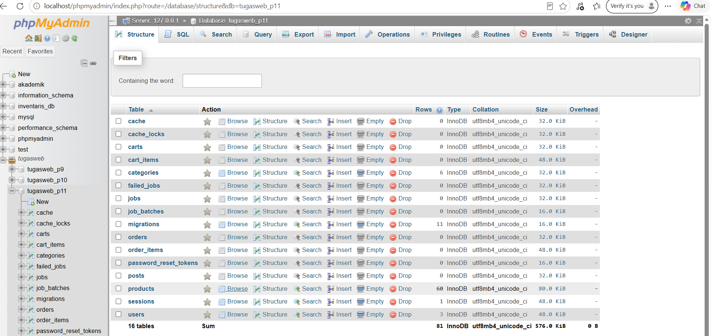

Foreign key pada `products.category_id` → `categories.id` (ON DELETE CASCADE).

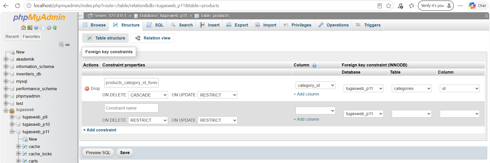

## 2. Seeders + factories (50+ produk)

`CategorySeeder`, `ProductSeeder` (memakai `ProductFactory`), dan `UserSeeder` dipanggil dari `DatabaseSeeder`. Hasil: 6 kategori, **60 produk** (kolom *Rows* pada gambar tabel di atas), dan 3 user.

## 3. Model + relationships + scope

- `Product`: `category()`, `cartItems()`, `orderItems()`, scope `scopeInStock()`.
- `Order`: `user()`, `items()`, scope `scopePaidOrAbove()`.

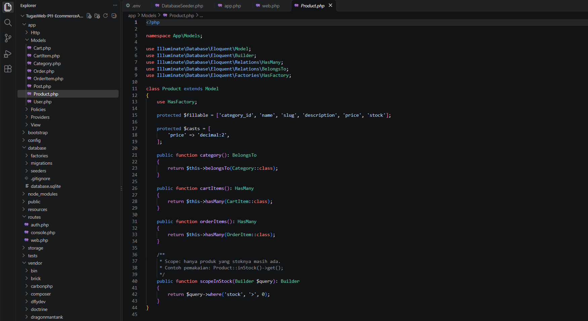

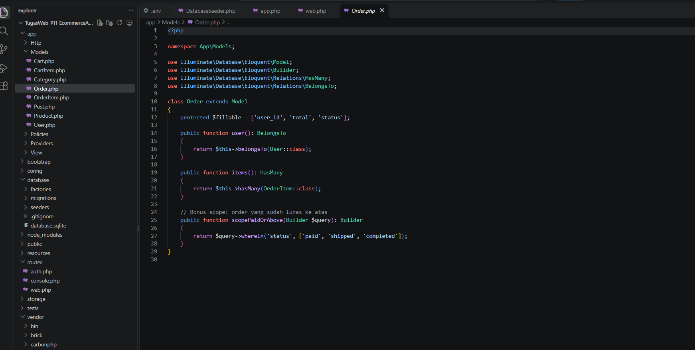

## 4. Dokumentasi 5 query Tinker

**Query 1** — 5 produk termahal beserta kategorinya (eager loading).

```php
Product::with('category')->orderByDesc('price')->take(5)->get()->map(fn($p) => "$p->name | $p->price | {$p->category->name}")->all();
```
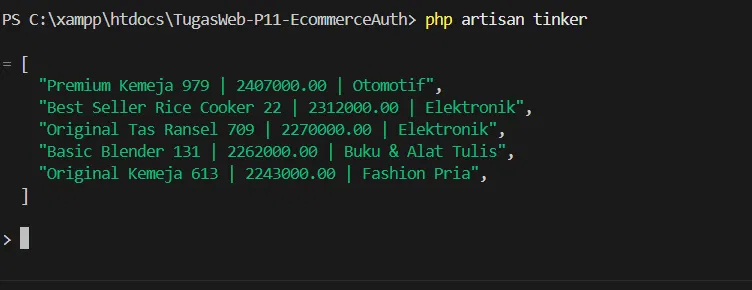

**Query 2** — jumlah produk yang stoknya masih ada (scope `inStock`).

```php
Product::inStock()->count();
```
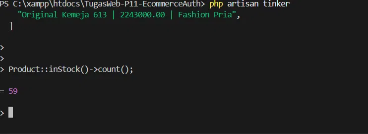

**Query 3** — kategori dengan produk terbanyak.

```php
Category::withCount('products')->orderByDesc('products_count')->first()->only(['name','products_count']);
```
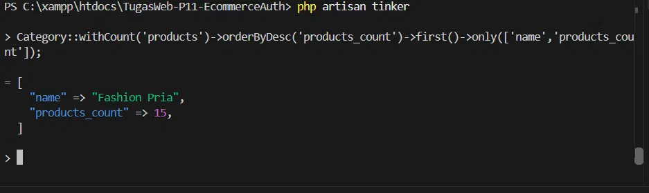

**Query 4** — membuat order beserta item-nya untuk user biasa.

```php
$user = User::where('email', 'user@example.com')->first();
$order = $user->orders()->create(['total' => 0, 'status' => 'pending']);
$product = Product::inStock()->first();
$order->items()->create(['product_id' => $product->id, 'quantity' => 2, 'price' => $product->price]);
$order->update(['total' => $product->price * 2]);
```
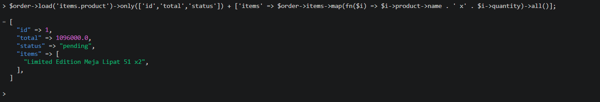

**Query 5** — order yang sudah dibayar atau lebih (scope `paidOrAbove`).

```php
Order::paidOrAbove()->with('items')->get()->map(fn($o) => ['order_id' => $o->id, 'status' => $o->status, 'item_count' => $o->items->sum('quantity')])->all();
```
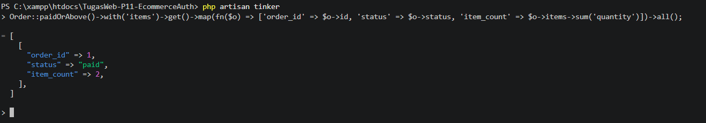

> Bonus: eager loading (`with()`) didemonstrasikan pada Query 1.

---

# Bagian B — Auth & Security

## 5. Install Breeze (login/register/logout)

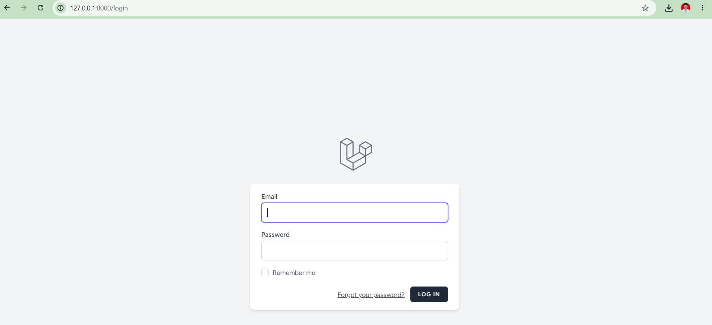

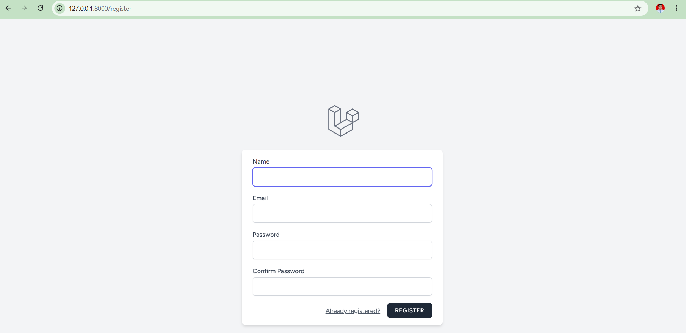

## 6. Multi-role (admin/editor/user) + custom middleware

Tabel `users` memiliki kolom `role`. `RoleMiddleware` memeriksa role dan memakai `abort(403)` bila tidak sesuai.

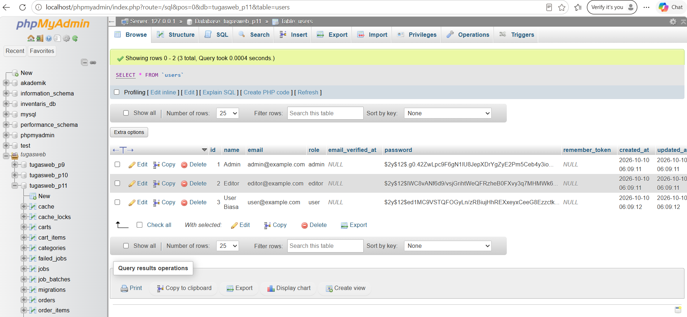

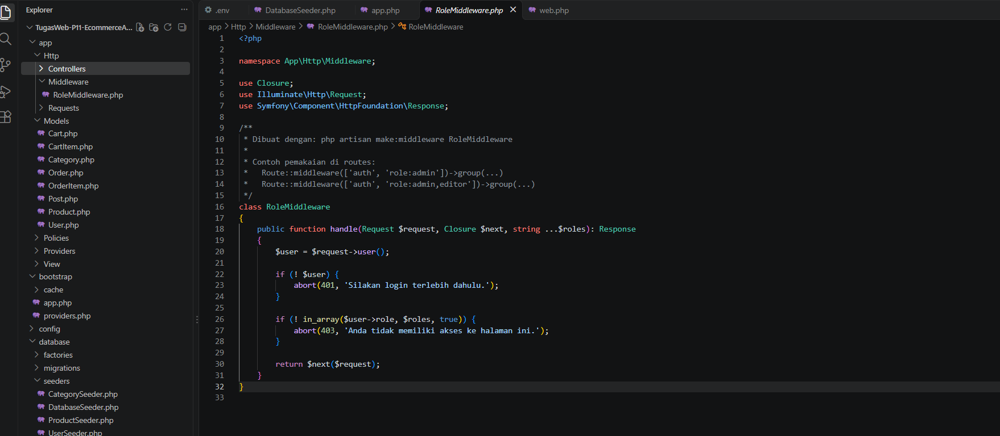

## 7. PostPolicy untuk otorisasi edit/delete

- **admin**: boleh edit/hapus semua post.
- **editor**: hanya post miliknya sendiri.
- **user**: tidak boleh edit/hapus.

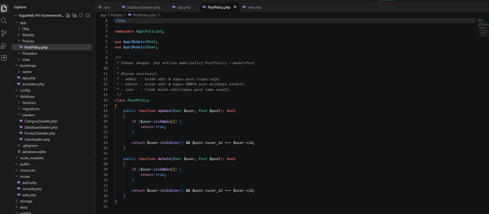

## 8. Route protection + testing incognito 2 role

Route lihat/buat post dilindungi `auth`. Route edit/update/hapus dilindungi `auth` + `role:admin,editor`, lalu kepemilikan diperiksa `PostPolicy` lewat `authorize()` di controller.

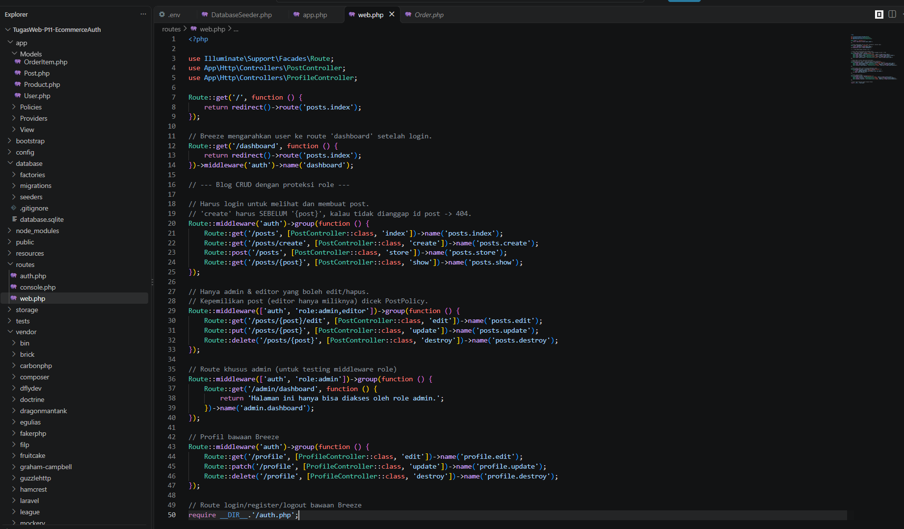

### a) Editor — buat, edit, hapus post sendiri

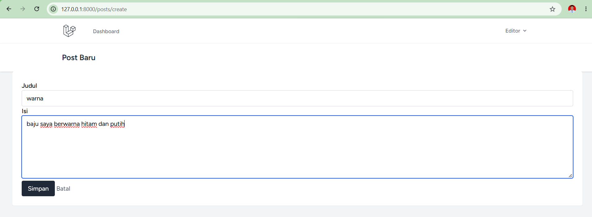

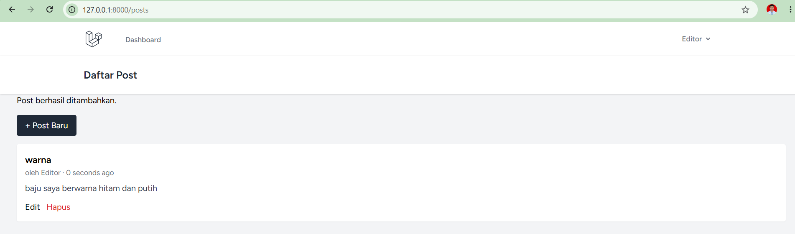

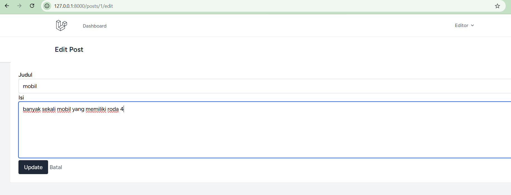

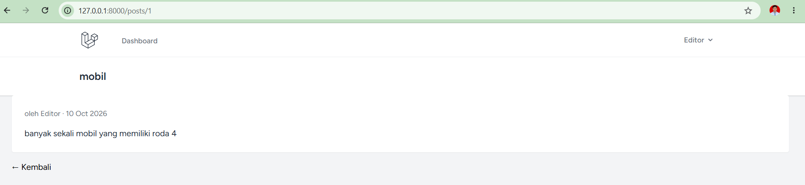

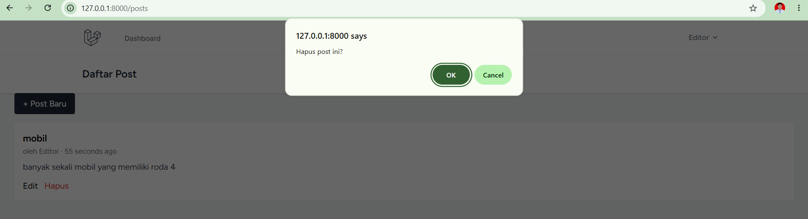

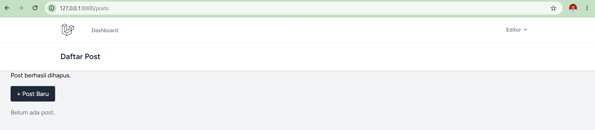

### b) User biasa (incognito) — ditolak


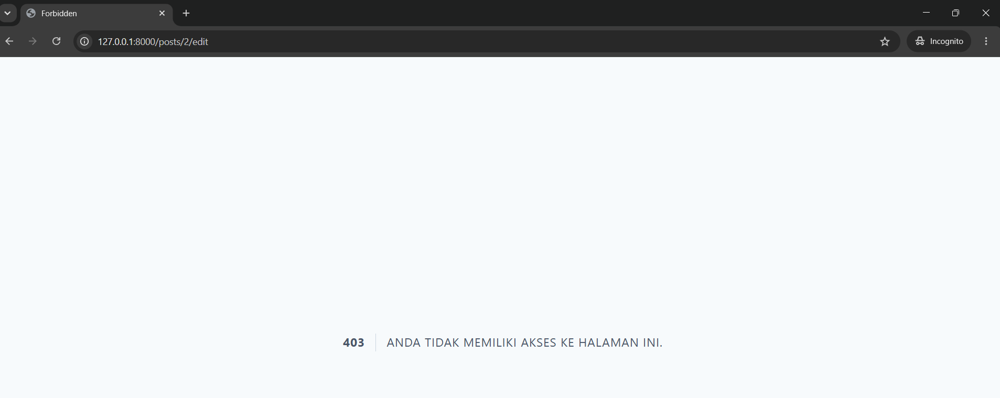

### c) Admin (incognito) — boleh mengelola post editor

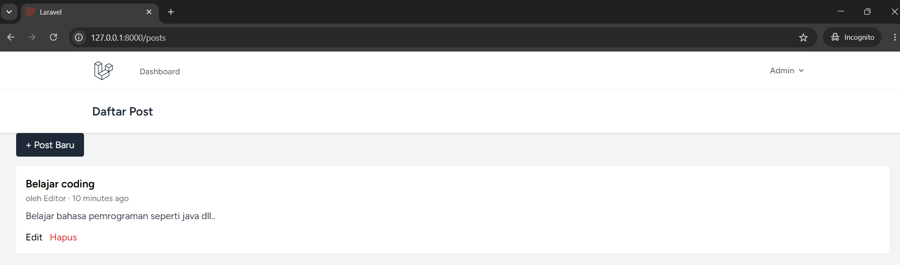

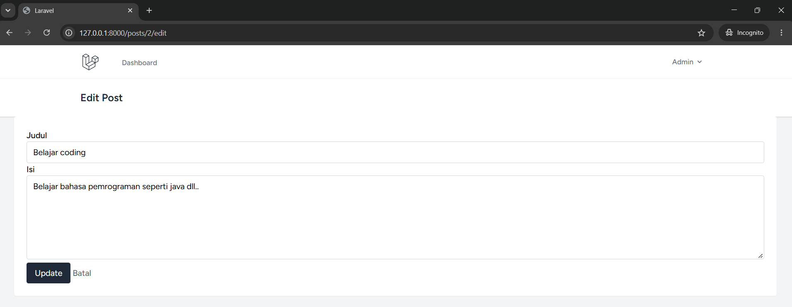

